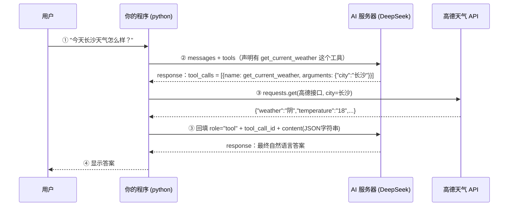

# function calling 工作流程（老师那张 `functioncalling流程图.png` 的文字版）

> 配套代码：`02.functioncalling.py`
> 老师在课上放了一张图，这里把它转成文字版，方便复习时对照代码看。

---

## 一、流程长什么样

```
  ① 用户提问
   "今天长沙的天气怎么样？"
            │
            ▼
  ┌──────────────────┐   ② messages + tools    ┌────────────────┐
  │    你的程序      │ ──────────────────────> │   AI 服务器    │
  │    (python)      │ <────────────────────── │  (DeepSeek)    │
  └──────────────────┘   response（tool_calls）└────────────────┘
            │
            │ ③ 本地执行 get_current_weather(city)
            │    ← 真正去请求外部接口（高德天气 API）
            ▼
  ┌──────────────────────────┐
  │  高德地图 天气接口        │
  │  restapi.amap.com/...    │
  └──────────────────────────┘
            │  拿到 {"location":"长沙","temperature":"18",...}
            │
            │ ③ 把它按 role="tool" + tool_call_id 回填进 messages
            ▼
  ┌──────────────────┐  messages（已含工具结果）┌────────────────┐
  │    你的程序      │ ──────────────────────> │   AI 服务器    │
  │                  │ <────────────────────── │                │
  └──────────────────┘    response（自然语言答案）└────────────────┘
            │
            ▼
     ④ 把答案显示给用户
   "长沙今天阴，18℃，体感偏凉…"
```

## 二、用 Mermaid 画（支持的编辑器里会自动渲染）



## 三、每一步对应代码里的哪一行

| 步骤 | 做什么 | 代码位置（`02.functioncalling.py`） |
|---|---|---|
| ② | 把 `messages` 和 `tools` 一起发出去 | `client.chat.completions.create(..., messages=dialog, tools=tools)` |
| — | 模型回 `tool_calls`（不是人话） | `msg = res.choices[0].message` → `msg.tool_calls` |
| ③ | 解析参数、本地执行 | `args = json.loads(tc.function.arguments)` → `get_current_weather(city)` |
| ③ | 结果回填 | `{"role": "tool", "tool_call_id": tc.id, "content": 结果字符串}` |
| ④ | 第二次请求拿人话 | `client.chat.completions.create(..., messages=dialog, tools=tools)` |

## 四、三个容易搞混的点

1. **模型不会执行你的代码。** 它只会说"我要调 `get_current_weather`，参数是 `{"city":"长沙"}`"，真正跑函数的是你的程序。这条线必须记牢 —— 也正因为如此，工具能干什么完全由你控制（安全边界）。
2. **`role: "tool"` 那条消息必须带 `tool_call_id`。** 模型可能一次要调 3 个工具（长沙/北京/上海），靠这个 id 才能把结果对上号。
3. **`content` 必须是字符串。** 所以要把字典 `json.dumps(...)` 一次，并且用 `ensure_ascii=False` 保住中文。

## 五、一句话总结

```
模型负责：判断要不要调工具 → 调哪个 → 传什么参数 → 最后组织语言
程序负责：真正执行 → 拿到真实数据 → 回填
```
